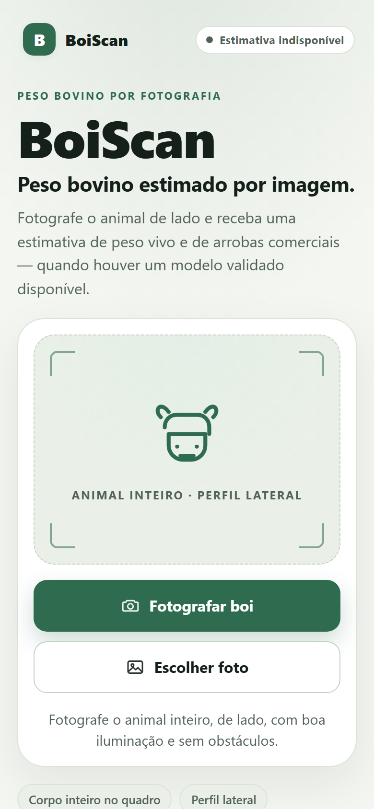
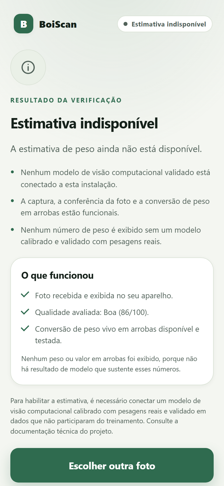

# BoiScan

**Peso bovino estimado por imagem.**

Aplicativo web mobile-first, em português brasileiro, para fotografar um bovino de
perfil lateral, conferir a qualidade da foto e — quando houver um modelo validado
conectado — receber uma estimativa de peso vivo e de arrobas comerciais de carcaça.

> **Estado atual:** MVP técnico funcional, ainda sem modelo de visão computacional
> validado. A base experimental (morfometria + regressão) está implementada e testada,
> mas **não é ativada no app público**. Por padrão, o app **não exibe peso**: mostra
> captura, pré-visualização, conferência técnica da imagem e uma mensagem clara de
> indisponibilidade.
>
> **Identidade:** BoiScan · **Package Android provisório:** `br.com.boiscan.app`
>
> `BOISCAN_006_COLLECTION_READY_WEIGHT_BLOCKED`

## O que funciona

- Seleção de foto pela galeria e captura pela câmera do dispositivo (input nativo
  `capture="environment"`, sem presumir permissões).
- Pré-visualização, substituição, remoção e rotação em 90°.
- Validação de formato e tamanho (JPG, PNG, WebP, AVIF, HEIC/HEIF; até 15 MB).
- Conferência técnica local: resolução, exposição, contraste e nitidez.
- Estados explícitos de carregamento, verificação, análise, resultado e erro
  recuperável.
- Motor desacoplado com três situações: modelo validado, modelo experimental e motor
  indisponível.
- Conversão de peso vivo em arrobas de carcaça com rendimento configurável
  (padrão ilustrativo de 52%).
- Resultado com modelo, versão, data, qualidade da foto e avisos de limitação.
- PWA com manifesto, ícones, shell offline e política de privacidade.
- Tema claro/escuro pelo sistema, layout responsivo e foco visível.
- Nenhum cadastro, GPS, telemetria ou envio de imagem por padrão.
- Migração automática da preferência de rendimento usada pela versão anterior
  (Arroba).
- Ferramenta experimental local de coleta: máscara editável, referência física com
  unidade, peso real/data, rascunho e exportação versionada — fora do app público.

## Motor experimental (não público)

A missão 005 adicionou análise de fotografias reais, ROI e uma ferramenta local de inspeção. A missão 006 completou o fluxo de coleta experimental (máscara, escala, peso real e exportação versionada). A base experimental continua **fora do app público**:

```text
foto → silhueta → morfometria → referência de escala → regressão calibrada
```

- A implementação está em `src/experimental/` e tem testes próprios.
- **Não está registrada no app público**: sem escala confiável, sem artefato válido
  e sem dados reais de pesagem, o motor continua indisponível.
- A ferramenta local permite revisar a máscara, marcar um comprimento conhecido com
  unidade, registrar peso real/data e exportar uma amostra elegível ou um rascunho.
- Um artefato sintético é marcado como simulação e nunca é apresentado como peso real.
- Nenhuma foto sai do dispositivo; não há API paga ou serviço externo.
- O dataset de treino é apenas um contrato em `data/`; nenhuma foto/pesagem real foi
  incluída.

Leia [docs/EXPERIMENTAL-ENGINE.md](docs/EXPERIMENTAL-ENGINE.md),
[docs/COLLECTION-PROTOCOL.md](docs/COLLECTION-PROTOCOL.md) e
[data/README.md](data/README.md) antes de coletar dados.

## Telas

Capturas do build local sem modelo validado (nenhum peso é exibido):

| Início (390 px) | Estimativa indisponível |
| --- | --- |
|  |  |

## Requisitos

- Node.js 22 ou superior (testado com Node.js 24).
- npm 10 ou superior.

Para empacotamento Android: JDK 17, Android SDK e Bubblewrap. Veja
[android/README.md](android/README.md).

## Executar

```bash
npm install
npm run dev
```

Acesse o endereço exibido (por exemplo `http://localhost:5173`).

### Testar no celular

1. Conecte o celular e o computador à mesma rede Wi-Fi.
2. Execute `npm run dev` (o servidor já usa `host: true`).
3. Abra no celular o endereço **Network** exibido no terminal, por exemplo
   `http://192.168.0.10:5173`.
4. Use **Fotografar boi** para abrir a câmera ou **Escolher foto** para a galeria.

O input nativo de arquivo funciona em navegadores móveis modernos (Chrome Android,
Safari iOS). A instalação como PWA e o service worker exigem **HTTPS** (ou
`localhost`). Em rede local via HTTP, o app funciona, mas o modo offline/instalação
pode não ser oferecido pelo navegador.

## Comandos

| Comando | Função |
| --- | --- |
| `npm run dev` | Servidor de desenvolvimento com HMR |
| `npm test` | Testes automatizados (Vitest + Testing Library) |
| `npm run typecheck` | Verificação TypeScript sem emitir arquivos |
| `npm run build` | Typecheck + build de produção em `dist/` |
| `npm run preview` | Serve o build de produção localmente |
| `npm run experimental:demo` | Treina um artefato **sintético** e demonstra o pipeline; não é peso real |
| `npm run experimental:train -- --input <csv> --output <json>` | Treino reproduzível com gates de dados |
| `npm run experimental:images` | Avalia o pipeline nas fotos reais e gera overlays ignorados |

Resultados da última execução: **162 testes aprovados**, typecheck limpo, build de
produção concluído e auditoria de dependências sem vulnerabilidades. Testes de
software não validam precisão preditiva.

## Configuração opcional

Copie `.env.example` para `.env.local` e ajuste apenas se necessário.

| Variável | Efeito |
| --- | --- |
| `VITE_ENGINE_ENDPOINT` | Conecta um backend de inferência que implemente o contrato de `docs/ARCHITECTURE.md`. A foto passa a ser enviada a esse serviço. |
| `VITE_ENABLE_SIMULATION=true` | Ativa a simulação **somente em desenvolvimento**. Gera números fictícios, marcados ostensivamente como simulação. Ignorada em produção. |

Sem `VITE_ENGINE_ENDPOINT`, o motor é `unavailable`: nenhum peso é calculado ou
exibido.

## Privacidade

- Não há login, cadastro, analytics ou GPS.
- Por padrão, a imagem permanece no navegador (`blob:` local) e não é armazenada.
- A única preferência persistida é o rendimento de carcaça, em `localStorage`
  (`boiscan.dressingPercent`); a chave antiga é migrada automaticamente.
- Se `VITE_ENGINE_ENDPOINT` for configurado, a foto é enviada apenas a esse
  serviço, por decisão do operador da instalação **e após consentimento explícito
  na tela de conferência**.
- Não há chaves ou credenciais no código.
- Política pública: [`/privacidade.html`](public/privacidade.html).

## Estrutura

```text
src/
  config.ts   nome, versão e identificador Android
  domain/     regras de negócio (arrobas, validação e qualidade de imagem)
  engine/     contrato do motor, adaptador remoto, simulação e motor indisponível
  experimental/ pipeline local de morfometria, escala, modelo, treinador e ferramenta visual
experimental/fixtures/  cinco fotos públicas licenciadas e manifesto de avaliação
  lib/        carregamento de imagem e análise de pixels no navegador
  hooks/      máquina de estados do fluxo
  components/ componentes de interface reutilizáveis
  screens/    telas do fluxo
scripts/experimental/  CLIs de treino, demo sintética e avaliação de fotos reais
data/         templates de coleta e features; dados privados ficam ignorados
public/       manifesto, ícones, service worker, favicon e política de privacidade
docs/         arquitetura, metodologia, motor experimental e status do MVP
android/      configuração de referência TWA e checklist da Google Play
```

## Android / Google Play

A estrutura de empacotamento Trusted Web Activity está preparada em
[`android/`](android/README.md), com package ID provisório, template do manifesto
Bubblewrap, template de Digital Asset Links e checklist completo.

- **targetSdk / compileSdk: 36** (exigência da Play para novos apps desde 31/08/2026).
- **Nenhum APK/AAB ou chave de assinatura foi gerado** nesta máquina: não há JDK 17,
  Android SDK nem Bubblewrap instalados.
- **Não publicar em produção enquanto a estimativa de peso estiver indisponível.**
  O app pode ser usado em teste interno/fechado, desde que a limitação seja explícita.
- Plano de distribuição: [android/README.md](android/README.md) e
  [android/CHECKLIST.md](android/CHECKLIST.md).

## Documentação

- [Arquitetura e contrato do motor](docs/ARCHITECTURE.md)
- [Estimativa de peso: viabilidade, dados e validação](docs/WEIGHT-ESTIMATION.md)
- [Motor experimental, escala, treino e bloqueios](docs/EXPERIMENTAL-ENGINE.md)
- [Avaliação com fotografias reais e ferramenta visual](docs/REAL-IMAGE-EVALUATION.md)
- [Checkpoint da Missão 005](docs/CHECKPOINT-005.md)
- [Checkpoint da Missão 006](docs/CHECKPOINT-006.md)
- [Protocolo de coleta experimental](docs/COLLECTION-PROTOCOL.md)
- [Contrato e privacidade dos dados experimentais](data/README.md)
- [Status do MVP e próximos passos](docs/MVP-STATUS.md)
- [Empacotamento Android/TWA](android/README.md)
- [Checklist Google Play](android/CHECKLIST.md)

## Limites conhecidos

- **Não há estimativa de peso real validada neste repositório.** O motor
  experimental está implementado, mas não há dataset real, coeficientes treinados
  com pesagens reais nem validação independente.
- A segmentação atual é um baseline clássico com ROI; nos cinco casos reais avaliados
  ela produziu apenas máscaras parciais ou rejeitou a imagem. Não é um segmentador de
  gado validado.
- O peso experimental permanece bloqueado: não há escala física, dataset de pesagens
  ou coeficientes calibrados para as fotos reais.
- A ferramenta de coleta permite exportar amostras elegíveis, mas **nenhuma amostra
  real de campo foi incluída** neste repositório. A escala marcada no mesmo plano
  reduz, mas não elimina, erros de perspectiva.
- A conferência de qualidade não detecta se o animal inteiro está no quadro; isso
  depende do futuro modelo de detecção/segmentação.
- A precisão de uma única foto RGB depende de escala física, distância, ângulo,
  lente, raça, idade e condição corporal. Veja
  [docs/WEIGHT-ESTIMATION.md](docs/WEIGHT-ESTIMATION.md).
- Não há backend FastAPI incluído, porque não há necessidade concreta enquanto não
  existir modelo para servir.
- O pacote Android depende de domínio HTTPS público, conta Play e assinatura, que
  ainda não existem.

## Governança desta missão

Missão 006: branch e PR publicados para revisão, sem merge nesta missão.

`NO_MERGE_006` · `NO_TAG` · `NO_RELEASE` · `NO_DEPLOY` · `NO_PAID_SERVICES` ·
`NO_PRIVATE_DATA`
